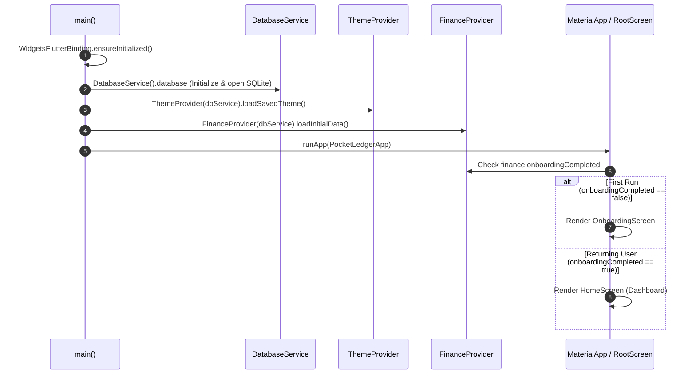
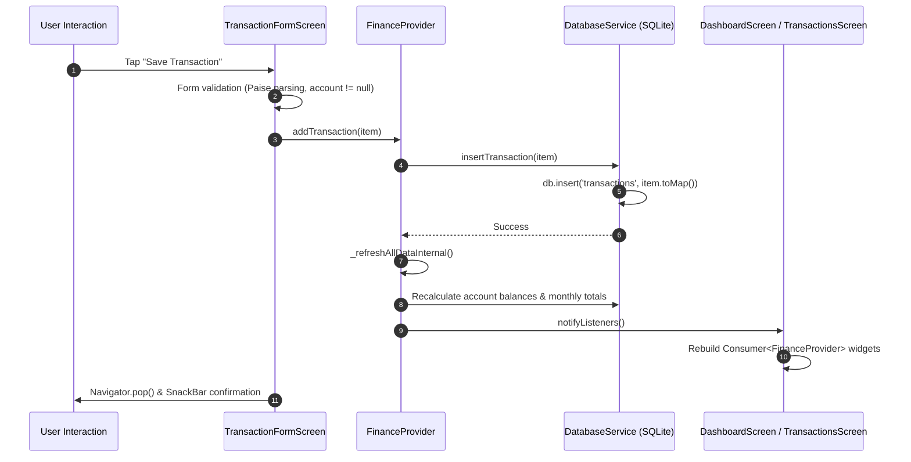

# PocketLedger Code Walkthrough & Architecture Guide

This document provides an in-depth architectural walkthrough of **PocketLedger**, an offline personal finance application built with Flutter, Provider, and SQLite (`sqflite`).

---

## 1. File & Directory Structure

```text
PocketLedger/
├── android/                        # Android native project files & manifest
├── lib/
│   ├── main.dart                   # Main entry point & MultiProvider setup
│   ├── models/                     # Immutable data models with serialization
│   │   ├── account.dart            # Cash, Bank, Digital Wallet entities
│   │   ├── budget.dart             # Category monthly budget entity
│   │   ├── category.dart           # Income/expense categories & icon mapping
│   │   └── transaction.dart        # Income, Expense, and Transfer transactions
│   ├── providers/                  # Central ChangeNotifier state managers
│   │   ├── finance_provider.dart   # Accounts, transactions, budgets, & metrics
│   │   └── theme_provider.dart     # System, Light, and Dark mode persistence
│   ├── screens/                    # Application screens and flows
│   │   ├── account_detail_screen.dart
│   │   ├── accounts_screen.dart
│   │   ├── budgets_screen.dart
│   │   ├── category_management_screen.dart
│   │   ├── dashboard_screen.dart
│   │   ├── home_screen.dart
│   │   ├── insights_screen.dart
│   │   ├── onboarding_screen.dart
│   │   ├── settings_screen.dart
│   │   ├── transaction_form_screen.dart
│   │   └── transactions_screen.dart
│   ├── services/                   # Data access and platform adapters
│   │   ├── database_service.dart   # SQLite schema, queries, & atomic transactions
│   │   ├── demo_data_service.dart  # 3-month synthetic data seeder
│   │   └── export_service.dart     # CSV generation & Formula Injection defenses
│   ├── utils/                      # Pure Dart formatters and date calculators
│   │   ├── currency_formatter.dart # Paise conversion & Indian Rupee formatting
│   │   └── date_helper.dart        # Half-open monthly date range calculations
│   └── widgets/                    # Reusable, design-system compliant UI widgets
│       ├── budget_progress_card.dart
│       ├── category_icon.dart
│       ├── confirm_dialog.dart
│       ├── empty_state_view.dart
│       ├── month_selector_header.dart
│       ├── summary_card.dart
│       └── transaction_list_item.dart
├── test/
│   ├── run_all_unit_verifications.dart # Native Dart standalone logic test runner
│   ├── currency_formatter_test.dart
│   ├── date_helper_test.dart
│   ├── financial_calculations_test.dart
│   └── csv_export_test.dart
└── pubspec.yaml                    # Dependencies and configuration
```

---

## 2. Application Startup Flow

The application boot sequence in `lib/main.dart` is carefully ordered to ensure database tables exist before any UI widget renders:



1. **`WidgetsFlutterBinding.ensureInitialized()`**: Wires the Flutter engine's binary messenger.
2. **Database Pre-warming**: Calls `await dbService.database` to execute table creation and index setup asynchronously before the UI builds.
3. **Provider Initialization**: `ThemeProvider` and `FinanceProvider` are injected at the root of the widget tree via `MultiProvider`.
4. **Onboarding Gate**: If `app_preferences` contains `onboardingCompleted = 'true'`, the app routes immediately to `HomeScreen`; otherwise, `OnboardingScreen` is displayed.

---

## 3. End-to-End Data Flow: Button Tap to UI Rebuild

Here is what happens when a user creates an expense transaction:



1. **User Action**: The user enters an amount, selects an account and category, and taps "Save".
2. **Form Validation**: `CurrencyFormatter.parseToPaise(input)` converts the string to an integer paise value. If null or <= 0, validation fails immediately without contacting the database.
3. **Provider Call**: `context.read<FinanceProvider>().addTransaction(...)` is called.
4. **SQLite Persistence**: `DatabaseService.insertTransaction` executes an SQL parameterized insert.
5. **State Synchronization**: `_refreshAllDataInternal()` re-queries account balances, transaction lists, category distributions, and budget usage within `FinanceProvider`.
6. **Reactive Rebuild**: `notifyListeners()` triggers granular rebuilds of all active `Consumer<FinanceProvider>` widgets (Dashboard cards, budget bars, transaction rows).

---

## 4. State Management: `setState` vs `Provider`

PocketLedger deliberately keeps state management simple, explicit, and lightweight:

| Scope | Mechanism | Where Used | Rationale |
| :--- | :--- | :--- | :--- |
| **Global / Shared State** | `Provider` (`ChangeNotifier`) | Account balances, transaction history, active monthly budgets, aggregated totals, theme mode. | Any mutation (e.g. adding an expense) affects multiple decoupled screens (Dashboard net worth, Account detail, Budgets tab, Insights charts). |
| **Local / Transient State** | `setState` | Form input controllers, active tab index (`HomeScreen`), search query text, modal filter dropdowns, dirty form flags. | This state is ephemeral and only matters while the specific screen or modal is on the navigation stack. Sharing it globally would introduce unnecessary coupling and rebuilds. |

---

## 5. Money Arithmetic: The Integer Paise Architecture

In personal finance applications, **floating-point arithmetic (`double`) is prohibited** because IEEE-754 floating-point representations introduce rounding errors (e.g., `0.1 + 0.2 = 0.30000000000000004`).

### PocketLedger's Solution:
- **1 Rupee = 100 Paise**.
- All monetary limits, balances, expenses, incomes, and transfers are strictly stored and computed as **Dart standard 64-bit integers (`int`)**:
  - `₹ 100.00` is stored as `10000`.
  - `₹ 0.50` is stored as `50`.
  - `₹ 1,250.75` is stored as `125075`.
- **Parsing** (`CurrencyFormatter.parseToPaise`): Splits the input string at the decimal point and multiplies the rupee portion by 100 before adding the 2-digit paise portion.
- **Display** (`CurrencyFormatter.formatPaise`): Divides paise by 100 and applies Indian number grouping (`₹ 1,00,000`).

---

## 6. Database Schema, Relationships, & Atomic Transfers

### Tables & Indices
```sql
-- 1. Accounts
CREATE TABLE accounts (
  id TEXT PRIMARY KEY,
  name TEXT NOT NULL,
  accountType TEXT NOT NULL, -- 'cash', 'bank', 'wallet'
  openingBalancePaise INTEGER NOT NULL DEFAULT 0,
  createdAt TEXT NOT NULL
);

-- 2. Categories
CREATE TABLE categories (
  id TEXT PRIMARY KEY,
  name TEXT NOT NULL,
  incomeOrExpense TEXT NOT NULL, -- 'income', 'expense'
  iconKey TEXT NOT NULL,
  colorValue INTEGER NOT NULL,
  isArchived INTEGER NOT NULL DEFAULT 0
);

-- 3. Transactions
CREATE TABLE transactions (
  id TEXT PRIMARY KEY,
  accountId TEXT NOT NULL,
  categoryId TEXT,
  transactionType TEXT NOT NULL, -- 'income', 'expense', 'transferOut', 'transferIn'
  amountPaise INTEGER NOT NULL,
  transactionDate TEXT NOT NULL,
  note TEXT,
  transferGroupId TEXT,
  createdAt TEXT NOT NULL,
  updatedAt TEXT NOT NULL,
  FOREIGN KEY (accountId) REFERENCES accounts(id) ON DELETE CASCADE,
  FOREIGN KEY (categoryId) REFERENCES categories(id) ON DELETE SET NULL
);
CREATE INDEX idx_transactions_date ON transactions(transactionDate);
CREATE INDEX idx_transactions_account ON transactions(accountId);

-- 4. Budgets
CREATE TABLE budgets (
  id TEXT PRIMARY KEY,
  categoryId TEXT NOT NULL,
  month INTEGER NOT NULL,
  year INTEGER NOT NULL,
  limitPaise INTEGER NOT NULL,
  UNIQUE(categoryId, month, year),
  FOREIGN KEY (categoryId) REFERENCES categories(id) ON DELETE CASCADE
);
```

### Atomic Transfers Pattern
Transfers are stored as **two linked records** with a shared `transferGroupId`:
1. `transferOut`: Negative impact on source account.
2. `transferIn`: Positive impact on destination account.

When inserting, updating, or deleting a transfer, SQLite's `db.transaction(...)` ensures both legs succeed or fail as an indivisible unit:
```dart
await db.transaction((txn) async {
  await txn.insert('transactions', transferOut.toMap());
  await txn.insert('transactions', transferIn.toMap());
});
```

---

## 7. Security & Defect Defenses

1. **CSV Formula Injection Defense (CWE-1236)**:
   Any user note starting with `=`, `+`, `-`, `@`, `\t`, or `\r` (even after whitespace) is escaped with a leading apostrophe (`'`) in `ExportService.sanitizeCsvField` to prevent formula execution in Excel or Google Sheets.
2. **Referential Deletion Protection**:
   `DatabaseService.deleteAccount` and `archiveOrDeleteCategory` explicitly inspect child references in `transactions` and `budgets` before performing a delete. If active references exist, deletion is rejected or gracefully downgraded to archiving.
3. **PopScope Dirty Navigation**:
   Forms track `_isDirty` and warn users upon accidental dismissal, preventing data loss.

---

## 8. Developer Guide: How to Add a New Field

Suppose you want to add an optional **`payee`** text field to transactions:

### Step 1: Update the Model (`lib/models/transaction.dart`)
1. Add `final String? payee;` to `TransactionItem`.
2. Add `this.payee` to the constructor and update `copyWith()`.
3. In `toMap()`, add `'payee': payee`.
4. In `fromMap()`, read `payee: map['payee'] as String?`.

### Step 2: Update SQLite Schema & Migration (`lib/services/database_service.dart`)
1. Increment `_dbVersion` from `1` to `2`.
2. In `_onUpgrade(Database db, int oldVersion, int newVersion)`:
   ```dart
   if (oldVersion < 2) {
     await db.execute('ALTER TABLE transactions ADD COLUMN payee TEXT;');
   }
   ```
3. Add `payee TEXT` to the table definition in `_onCreate` for new installs.

### Step 3: Update Transaction Form (`lib/screens/transaction_form_screen.dart`)
1. Add `late TextEditingController _payeeController;` and initialize in `initState()`.
2. Add a `TextFormField` inside the form:
   ```dart
   TextFormField(
     controller: _payeeController,
     decoration: const InputDecoration(labelText: 'Payee / Merchant'),
     onChanged: (_) => _isDirty = true,
   )
   ```
3. Pass `payee: _payeeController.text.trim()` when calling `finance.addTransaction(...)`.

### Step 4: Display in UI (`lib/widgets/transaction_list_item.dart`)
Render the payee text below the category name when present.
